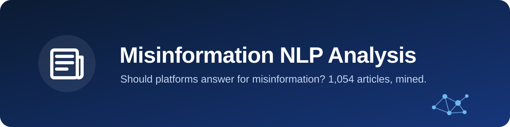
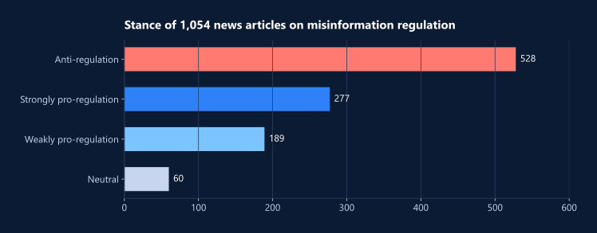
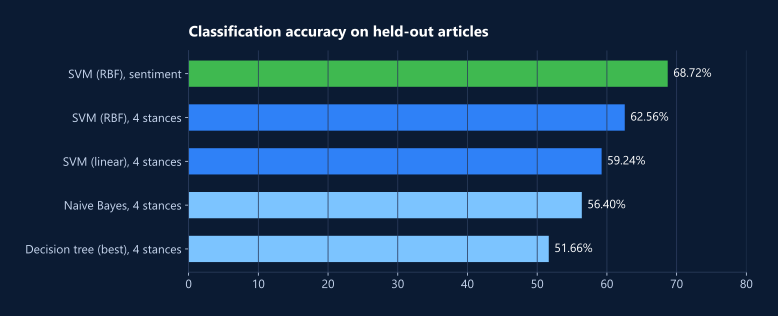

<div align="center">




</div>

**Should social media companies be held responsible for misinformation?** This text-mining project collects 1,054 news articles on the question from three sources. It labels each article's stance with a BERT model, then uses unsupervised learning to map what the coverage talks about and supervised learning to predict where an article stands.

## Highlights

- **Coverage leans against regulation.** 528 of the 1,054 articles (50%) argue against holding platforms responsible.
- **SVM reads sentiment best, at 68.72% accuracy.** Telling apart four stances is harder: 62.56% with an RBF kernel.
- **Five topics emerge.** LDA separates regulatory, technological, political and user-focused threads in the coverage.



## Results



With four uneven classes, chance level is about 50% (always guessing "anti-regulation"). So the stance models beat it by a modest margin, and the sentiment model does clearly better.

## Approach

| Step | Notebook | What happens |
| --- | --- | --- |
| 1. Collect and prepare | `01_collect_and_preprocess` | Pull articles from NewsAPI, MediaStack and Google News RSS; clean, tokenize, stem and lemmatize; build count and TF-IDF features; label stance with BERT |
| 2. Explore | `02a_kmeans_clustering`, `02b_hierarchical_clustering_r`, `02c_lda_topics`, `02d_association_rules.R` | K-Means with silhouette analysis, hierarchical clustering (cosine distance), LDA topic modeling, Apriori association rules |
| 3. Classify | `03_classification` | Naive Bayes, decision trees (entropy and Gini, varying depth), and SVM with linear, RBF and polynomial kernels |

## Repository

```
notebooks/   the analysis, in order (01 to 03)
data/        raw pulls from each source, the labeled set, and the processed text features
assets/      charts and banner used in this README
```

## Run it

The notebooks were written in Google Colab. Notebook 1 reads its API keys from the environment variables `NEWSAPI_KEY` and `MEDIASTACK_KEY`; both services offer free keys.

```
pip install -r requirements.txt
jupyter notebook notebooks/
```

The R parts need an R kernel (IRkernel) with `arules`, `arulesViz` and `tm`.
